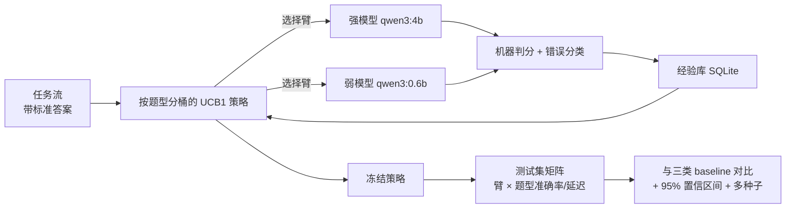

# 设计与验证说明

## 1. 选题定位

作业二二选一，本项目选择 **(b) 自己做一个简单的 RSL 系统**。

在本项目中，"RSL（Recursive Self-Learning）"被具体定义为：

> **系统把自己执行任务的结果转成经验，用经验改变下一次的行为，并在"没见过的题"上验证这种改变是否真的更好。**

它**不包含**模型权重更新（不微调、不训练），也不是强化学习训练流程。系统学习的对象是**策略**（哪种题交给哪个模型），经验以结构化记录保存在本地数据库中。这与课程中 ModelRouter（模型路由）、Jev（System-1 快模型做前置判断）的主题一致。

## 2. 系统架构

## 3. 关键设计决策

| 决策 | 做法 | 理由 |
|---|---|---|
| **判分不依赖 LLM** | 题目答案由程序生成、唯一正确；用正则抽取"答案："后比对 | 避免"LLM 裁判"带来的 reward hacking 与额外成本 |
| **训练/测试严格隔离** | 测试答案只用于计分，从不进入提示或经验库 | 防止答案泄漏造成的虚高 |
| **按题型分桶** | 每个题型独立维护一套 UCB1 统计 | 不同题型难度差异大；全局单一策略会被某个题型主导 |
| **UCB1 而非 ε-greedy** | 每桶每臂先各拉一次，之后按"均值 + 探索奖励"选择 | 探索量随不确定性自动调整，无需手调 ε |
| **收缩估计（关键）** | 题型内均值向该臂的全局均值收缩：`(sum_kind + w·global_mean) / (n_kind + w)`，w=3 | 见下方"开发中的一次失败"——不收缩时小样本噪声会把简单题错配给弱模型 |
| **成本项进入训练** | reward = `正确 − λ·(延迟/参考延迟)`，λ=0.2，参考延迟 8 s | 让"同样准但快 4 倍"真正体现为收益；λ=0 时退化为纯准确率 |
| **两个臂** | 强模型 `qwen3:4b` / 弱模型 `qwen3:0.6b` | 成本差约 4 倍，能形成真实的"准确率—延迟"权衡；开发中试过的第三个臂（同模型不同提示）被证明又慢又差，已剔除 |
| **成本感知后验分析** | 训练期 reward = 正确与否；评估期用矩阵做 λ 扫描 | 避免训练期引入额外参数；后验扫描可一次算清所有 λ 的收益 |
| **置信区间** | 所有比例都给 Wilson 95% CI | 样本量小，单点估计容易被过度解读 |
| **多种子重跑** | 固定任务集，改变数据顺序跑 3 次 | 任务集固定才能保证三次的测试集完全一致；顺序变化衡量策略对数据的敏感性 |
| **策略切换率** | 统计"最终按题型选择"与"一刀切最优臂"不同的题型占比 | 直接回答"学习到底改变了什么"；切换率为 0 说明学习没有产生信息 |
| **错误分类** | 记录 correct / wrong_value / format_error / no_answer / no_answer_truncated / empty | 比单一准确率更有诊断价值 |

## 4. 验证方法

1. **测试集矩阵**：冻结策略后，对每个臂在测试集的每个题型上各跑一遍，得到 `(臂 × 题型)` 的准确率与平均延迟。所有策略的评估都从这张矩阵推出，**不额外调用模型**，因此各策略之间可比。
2. **四类对照**：随机选臂 / 固定最优单臂 / 按题型事后最优（上界）/ 本系统学到的策略。
3. **统计**：Wilson 95% 置信区间；结果按 3 个 seed 汇总（合并计数后再算区间）。
4. **数据集体检**（`check_dataset.py`）：检查重复题、题型比例、难度指标（答案量级、答案位数、题干数字位数、题干字符数）在训练/测试间是否对齐，防止"测试集更容易"导致虚高。
5. **可复现**：`run_config.json` 记录全部参数与时间；`tasks.json` 导出完整任务集；每个 seed 的 `summary.json` 与 `experience.csv` 保留原始记录。

## 5. 与"递归修正"的区别

本项目**没有**采用"模型答错 → 把标准答案喂回去让它改 → 提炼规则"的路线。那种路线的隐含前提是"模型在被提示标准答案后能改对"，而对能力边界之外的错误（例如它根本判断不出该填 null）往往无效，还会把学习入口限制在最容易的那类错误上。

本项目的学习入口是**全部调用结果**（不要求被修正成功），因此能覆盖模型能力边界之外的失败——代价是学习信号更粗（0/1），需要靠按题型分桶与置信区间来降低噪声。

## 6. 开发中的一次失败（为什么加了收缩）

第一版只做了"按题型分桶的 UCB1"，没有收缩、没有成本项。结果是**系统比一刀切还差**：

- 强模型在测试集上拿到 20/20（100%），而系统学到的策略只有 15/20 与 17/20（75% / 85%）；
- 原因：每个题型每臂只有约 5 次训练调用，强模型偶尔一次"思考过程吃光 token 导致空答案"，该题型的均值就从 1.0 掉到 0.8；弱模型凑巧答对两次就变成 1.0 —— 于是系统把乘法、逻辑题交给了弱模型，白白丢分；
- 这暴露了小样本 bandit 的通病：**方差 >> 真实差异时，"择优"就是过拟合噪声**。

修正有两条，缺一不可：

1. **收缩估计**：题型内均值向该臂的全局均值收缩（伪计数 w=3）。等价于"先验相信该臂的整体水平，题型内样本足够多才允许推翻它"。
2. **成本项进入训练**：λ>0 时，正确但慢的调用不再与"正确且快"等价，系统才有动机把"两边都答对"的题型交给弱模型。

## 7. 已知局限

1. **题库范围窄**：只有可机器判定的数值/抽取题，reward 依赖标准答案；开放式任务需要引入 LLM 裁判（如 Jev，$0.042/百万输入 token、输出免费）。
2. **每题型样本有限**：每题型每轮仅若干次调用，置信区间较宽；扩大题型内样本量会线性增加耗时。
3. **只有两个臂**：更细的提示策略臂未纳入（开发中验证过，收益被成本抵消）。
4. **延迟受环境影响**：同一台机器上，桌面程序占用显存、电源模式都会影响延迟，因此成本分析给的是相对量级而非绝对值。
5. **无跨机器的稳定性保证**：temperature=0 也不能保证跨硬件/版本的完全一致。

## 8. 与课程内容的对应

- **ModelRouter 主题**：本项目学的正是"哪类请求交给哪个模型"，即路由策略；区别是它用在线经验而不是人工配置。
- **Jev / System-1 主题**：老师演示的"两个快模型一致就采用、不一致再升级到强模型"是一种**固定的门控规则**；本项目是把这类规则**从经验中学出来**，并且用测试集矩阵量化"学到了多少"。
